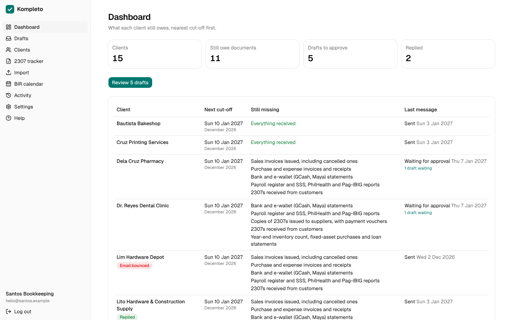

# Kompleto

**A document and BIR-deadline chaser for Philippine bookkeepers.**

Every month, bookkeepers chase each client for receipts, bank statements, GCash screenshots and BIR Form 2307s, usually by hand in Viber threads and one Excel file per client. Kompleto does the chasing:

- a **BIR deadline calendar** for each client (0619-E, 1601-C, 2550Q, 1701Q and more);
- a **checklist** of the documents each client still owes for each month or quarter;
- **reminder emails in Taglish or English**, sent only after the bookkeeper approves them;
- a **private upload link** that clients open on their phone, with no app and no login; every file is scanned for viruses before it is kept;
- reminders that **stop** once the client uploads everything or replies;
- a **2307 tracker** showing which Payors have sent their 2307s and which are still missing;
- a **dashboard** of what's missing, nearest cut-off first;
- **staff logins:** the owner invites up to 5 staff, and the activity log names who did what.



**See it working:** a [2-minute walkthrough video](docs/showcase/walkthrough.mp4) and more screenshots in [`docs/showcase/`](docs/showcase/), all of a made-up demo firm.

Kompleto never keeps books, computes tax, files returns or produces BIR-format files (`docs/adr/0004-stay-outside-bir-accounting-system-rules.md`). It only chases documents.

## Status

| Stage | Status |
|---|---|
| Research, spec, architecture (phases 1–9) | Done |
| **M1** Outbox: send at most once, audit log | Done |
| **M2** Firms, login, Clients, BIR calendar, checklist, schedule | Done |
| **M3** Drafts, approval, pre-send checks, "copy for Viber" | Done |
| **M4** Phone upload page, encrypted files, auto-deletion | Done |
| **M5** Replies, bounces, dashboard, 2307 tracker | Done |
| **M6** Export, account closing, activity log, send budget, hardening | Built; going live waits for the domain |
| **M7** The bookkeeper's pages as a React app | Done |
| **M8** Demo Firm, virus scanning, help and privacy pages, screenshots, video | Done; the legal pages are drafts for the owner (`docs/legal.md`) |
| **M9** Staff logins: an owner and up to 5 staff | Done |
| **M10** "Request an account" page, approved by the operator | Done |
| **M11–M13** Xero/QuickBooks import, 2307 matching, payroll chasing | **Next** |
| Go live, then 3–5 free 4-week pilots | After M13, once the domain is bought and a bookkeeper says yes |

All 28 acceptance criteria in `docs/product/p1-spec.md` have tests, and they pass. One part of E2, passing SPF, DKIM and DMARC, can only be checked on the real domain.

## How it's built

One Rust program, in two parts:

- **`src/engine/`** is reusable for later products: jobs and scheduler, the approval outbox, pre-send checks, the LLM client, sending and receiving email, the audit and cost logs.
- **`src/kompleto/`** is the product: Firms and Clients, the BIR calendar, the document checklist, the 2307 tracker, the upload page and the web API.

`engine` never depends on `kompleto`; CI fails the build otherwise. Safety rules live in code, not prompts: nothing is sent without an approval that matches the exact text, and each email is sent at most once, even after a crash.

| Part | Technology |
|---|---|
| Backend | Rust, axum, sqlx, PostgreSQL 17 |
| Bookkeeper's pages | React with Vite, TypeScript, shadcn/ui, Tailwind, over a JSON API (`docs/frontend.md`) |
| Client upload page | Server-rendered HTML, built to load fast on cheap phones |
| Email | Resend (sending), Cloudflare Email Routing (replies), Mailpit in development |
| AI | Claude via API key, for wording reminders only; fixed templates when no key is set |

## Run it locally

You need Docker, Rust (the version is pinned in `rust-toolchain.toml`), Node 22 and pnpm (`corepack enable`).

```sh
cp .env.example .env          # once
docker compose up -d          # Postgres 17 and Mailpit
cargo run -- migrate
cargo run -- firm add --name "Santos Bookkeeping" --email you@example.com
pnpm --dir web install
pnpm --dir web build          # the React app, served by the Rust server
cargo run -- serve            # http://127.0.0.1:3000
```

To scan Uploads for viruses as production does, run `docker compose --profile scan up -d` as well and set `CLAMD_ADDR=127.0.0.1:3310` in `.env`.

Log in with the email you gave. The login link arrives in Mailpit at http://localhost:8025, where every email lands in development; nothing leaves your machine.

**Working on the React app:** run `pnpm --dir web dev` as well and open http://localhost:5173, which reloads as you edit and passes `/api` to the Rust server. Set `PUBLIC_BASE_URL=http://localhost:5173` in `.env` so login links open there.

Other commands:

| Command | What it does |
|---|---|
| `cargo run -- demo` | Sends one approved email through the outbox into Mailpit |
| `cargo run -- requests` | Account requests from the sign-up page; `requests approve ID` opens the firm and emails its owner a welcome login link, `requests decline ID` deletes it, `requests decline-all` clears a flood |
| `cargo run -- dev-schedule --date 2026-11-01` | Creates the reminder Drafts due on that date, to try the whole loop before real dates come round |
| `cargo run -- llm-costs --month 2026-11` | AI cost per Firm for that month |
| `cargo run -- gen-key` | Makes a new key for encrypting uploaded files |
| `cargo run -- demo-firm --email you@example.test --date 2027-01-07` | A demo firm with 15 clients and 45 days of history, replayed through Kompleto's own code; serve with `DEMO_DATE=2027-01-07` to see it as of that day, a few days before the December cut-off |

## Tests and checks

```sh
cargo fmt --check
cargo clippy --all-targets --all-features --locked -- -D warnings
cargo test --all-features --locked
```

`--all-features` includes the E1 crash test. `cargo test` also writes the API's TypeScript types into `web/src/api/generated/`; commit them. After changing SQL, run `cargo sqlx prepare -- --all-targets --all-features` and commit `.sqlx/`, because CI compiles without a database.

The React app's checks:

```sh
pnpm --dir web lint
pnpm --dir web typecheck
pnpm --dir web test
pnpm --dir web build
pnpm --dir web e2e            # browser tests, against a running `cargo run -- serve`
```

## Project layout

```
src/engine/       reusable engine
src/kompleto/     the product, including its JSON API (src/kompleto/web/api/)
web/              the React app; web/e2e/ holds the browser tests
templates/        the Client's server-rendered upload page
migrations/       database migrations
tests/            Rust tests; each acceptance criterion's test starts with its ID
deploy/           service, backup, tunnel and email-worker files for going live
docs/             spec, architecture, decisions, research, deploy guide, outreach
.claude/skills/   the coding skills Claude follows (Rust, React, shadcn)
```

## Documents

| Read | For |
|---|---|
| `docs/product/p1-brief.md` | What Kompleto is and for whom |
| `docs/product/p1-spec.md` | The spec and acceptance criteria |
| `docs/architecture.md` | How it's built, and the build order |
| `docs/frontend.md` | React conventions and folder layout |
| `docs/decisions.md` | Every decision the owner made, dated |
| `docs/legal.md` | The help page, privacy notice, terms and data processing agreement |
| `docs/deploy.md` | Going live, step by step |
| `AGENTS.md` | The rules for working on this repository |
| `GLOSSARY.md` | The project's words: Firm, Client, Payor, Cut-off… |
